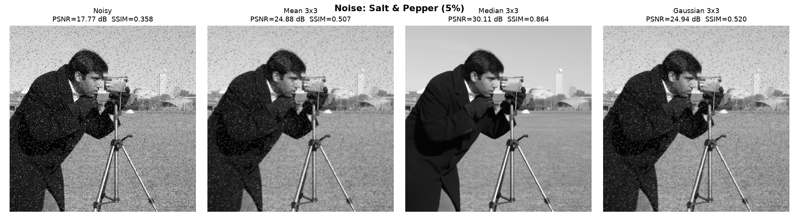
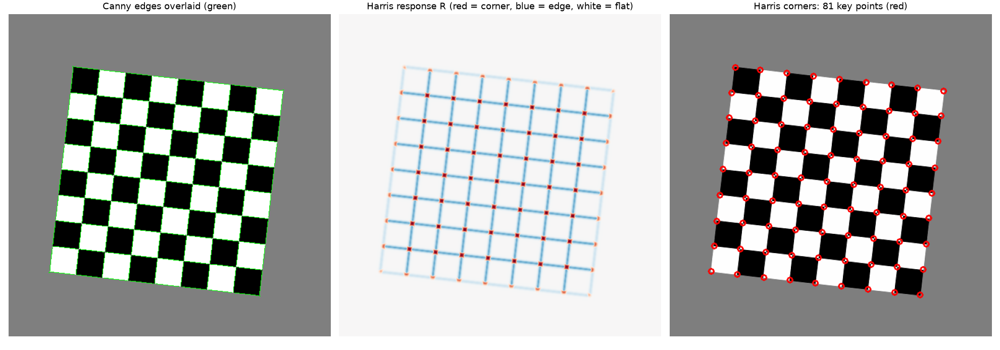
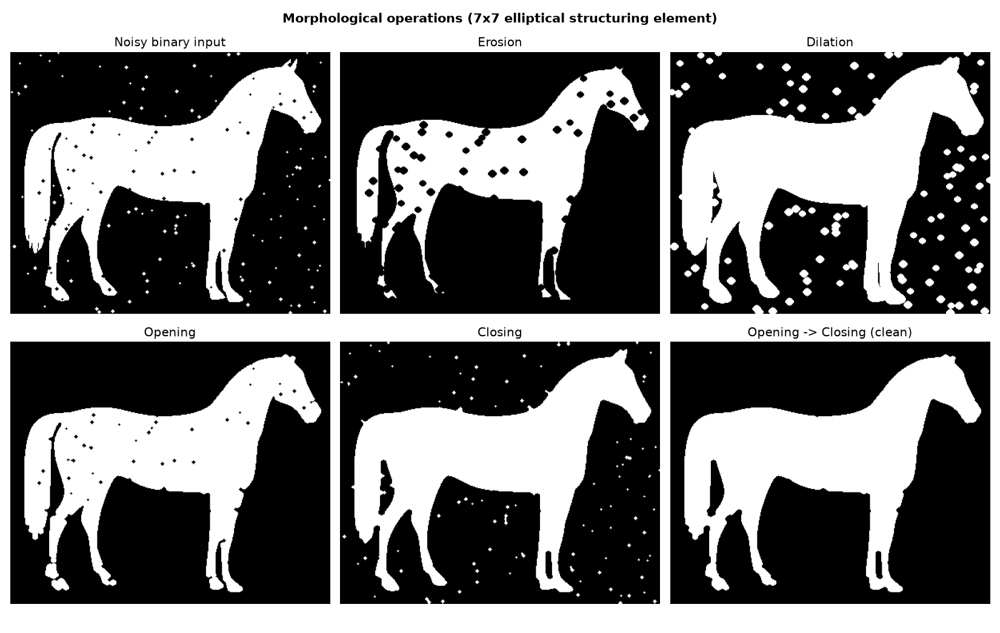
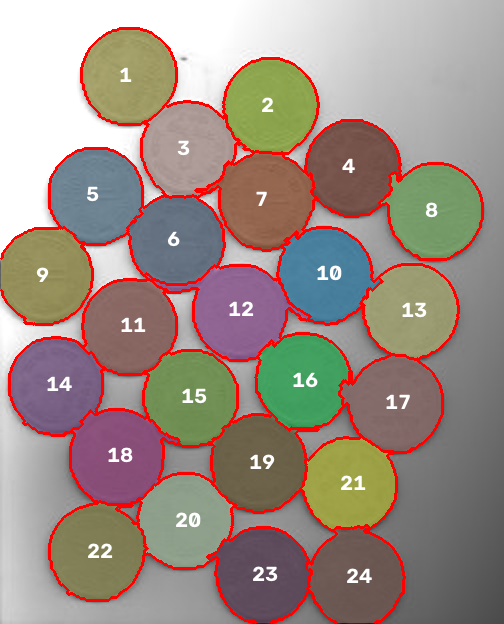
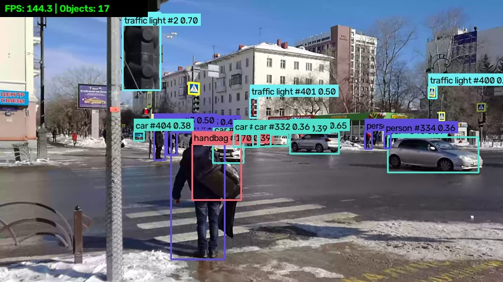

# Computer Vision Assignments (21CSE454T)

Python programs and PDF reports for the five unit-wise assignments of the Computer Vision course.

| | |
|---|---|
| **Name** | Srevarshan |
| **Register Number** | RA2311026050039 |
| **Year / Department / Section** | 4th Year / CSE (AIML) / A |
| **Subject** | Computer Vision (21CSE454T) |

## Assignments

| Unit | Topic | Program | Report |
|---|---|---|---|
| 1 | Image Filtering - Mean, Median and Gaussian filters on noisy images | [unit1_filtering.py](Unit1_Filtering/unit1_filtering.py) | [PDF](Reports/Unit1_Image_Filtering.pdf) |
| 2 | Edge & Point Detection - Canny edges and Harris corners | [unit2_edge_corner.py](Unit2_Edge_Point_Detection/unit2_edge_corner.py) | [PDF](Reports/Unit2_Edge_and_Point_Detection.pdf) |
| 3 | Binary Shape Analysis - morphology and 8-direction chain code | [unit3_morphology_chaincode.py](Unit3_Binary_Shape_Analysis/unit3_morphology_chaincode.py) | [PDF](Reports/Unit3_Binary_Shape_Analysis.pdf) |
| 4 | Image Segmentation - adaptive Otsu thresholding and Watershed | [unit4_segmentation.py](Unit4_Image_Segmentation/unit4_segmentation.py) | [PDF](Reports/Unit4_Image_Segmentation.pdf) |
| 5 | Modern Object Recognition - real-time YOLO detection and tracking | [unit5_yolo_detection.py](Unit5_Object_Recognition/unit5_yolo_detection.py) | [PDF](Reports/Unit5_Modern_Object_Recognition.pdf) |

Each report contains: Aim, Algorithm / Procedure, Python Code, Input Image, Output Screenshots, Result Analysis / Observations and Conclusion.

## Results

**Unit 1 - Filtering.** The filters are written from scratch with NumPy and give the same output as OpenCV. The Median filter works best for salt-and-pepper noise (PSNR 17.8 dB to 30.1 dB). The Gaussian filter works best for Gaussian noise.



**Unit 2 - Edges and corners.** Canny is implemented stage by stage (smoothing, Sobel gradients, non-maximum suppression, double threshold, hysteresis). Harris uses the structure tensor. All 81 corners of the distorted checkerboard are found.



**Unit 3 - Morphology and chain code.** Erosion, dilation, opening and closing clean a noisy silhouette. The boundary is stored as a 1620-step Freeman chain code, and the boundary can be rebuilt exactly from it.



**Unit 4 - Segmentation.** Global Otsu fails under uneven lighting. Local (adaptive) Otsu gives a clean mask, and marker-based Watershed separates all 24 touching coins.



**Unit 5 - Object recognition.** A pre-trained YOLO11n model (COCO, 80 classes) with ByteTrack tracking runs at about 146 FPS on an RTX 4050 laptop GPU. It draws boxes with the class name, track ID and confidence score.



## Setup

```bash
python3 -m venv venv
source venv/bin/activate
pip install -r requirements.txt
```

On Ubuntu, if `python3 -m venv` fails, install the venv package first: `sudo apt install python3-venv`.

## Running the programs

Run each program from the project folder. Its figures and console output are saved in that unit's `outputs/` folder.

```bash
python Unit1_Filtering/unit1_filtering.py
python Unit2_Edge_Point_Detection/unit2_edge_corner.py
python Unit3_Binary_Shape_Analysis/unit3_morphology_chaincode.py
python Unit4_Image_Segmentation/unit4_segmentation.py
python Unit5_Object_Recognition/unit5_yolo_detection.py
```

Unit 5 options:

```bash
python Unit5_Object_Recognition/unit5_yolo_detection.py --source 0 --show          # webcam, press q to stop
python Unit5_Object_Recognition/unit5_yolo_detection.py --source my_video.mp4 --conf 0.5
```

The YOLO weights (`yolo11n.pt`) are downloaded automatically on the first run. The program uses the GPU if one is available, otherwise the CPU.

## Building the PDF reports

```bash
python build_reports.py        # all units
python build_reports.py 3      # only Unit 3
```

The reports are saved in `Reports/`. Run the unit programs first, because the reports use their saved outputs. The PDF builder uses the Liberation fonts (`/usr/share/fonts/truetype/liberation`), which come pre-installed on Ubuntu (package `fonts-liberation`).

## Project structure

```
├── Unit1_Filtering/                 unit1_filtering.py, outputs/
├── Unit2_Edge_Point_Detection/      unit2_edge_corner.py, building.jpg, outputs/
├── Unit3_Binary_Shape_Analysis/     unit3_morphology_chaincode.py, outputs/
├── Unit4_Image_Segmentation/        unit4_segmentation.py, water_coins.jpg, outputs/
├── Unit5_Object_Recognition/        unit5_yolo_detection.py, input_video.webm, outputs/
├── Reports/                         the five PDF reports
├── report_engine.py                 PDF layout (cover page, sections, figures, tables)
├── build_reports.py                 report text for Units 1-4
├── build_unit5.py                   report text for Unit 5
└── requirements.txt
```

## Image and video sources

| File | Source | License |
|---|---|---|
| Cameraman (Unit 1), horse silhouette (Unit 3) | scikit-image sample data | BSD |
| `building.jpg` (Unit 2) | [Brick facade with a regular grid of windows in Quebec City](https://commons.wikimedia.org/wiki/File:Brick_facade_with_a_regular_grid_of_windows_in_Quebec_City.jpg) by Wilfredor, Wikimedia Commons | CC BY-SA 4.0 |
| Checkerboard (Unit 2) | Generated by the program | - |
| `water_coins.jpg` (Unit 4) | OpenCV documentation sample image | Apache 2.0 |
| `input_video.webm` (Unit 5) | [Kruciĝo de stratoj Respubliko kaj Orĝonikidze (Tjumeno)](https://commons.wikimedia.org/wiki/File:Kruci%C4%9Do_de_stratoj_Respubliko_kaj_Or%C4%9Donikidze_(Tjumeno).webm) by RG72, Wikimedia Commons (480p version) | CC BY-SA 4.0 |
| YOLO11n weights | [Ultralytics](https://github.com/ultralytics/ultralytics) | AGPL-3.0 |
